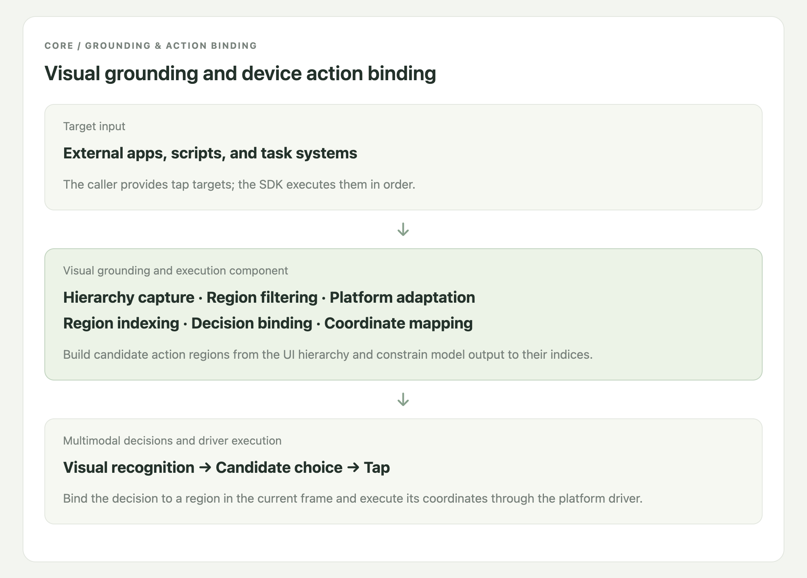

<h1 align="center">Jev Phone</h1>
<p align="center"><strong>A multimodal tap SDK for three mobile platforms, with millisecond-level local processing</strong></p>
<p align="center">Android · iOS · HarmonyOS<br>Physical devices and emulators · Single and sequential taps · Python · MIT</p>
<p align="center"><a href="README.en.md">English</a> · <a href="README.md">中文</a></p>

Jev Phone connects Jev multimodal decisions to mobile devices, providing an independent tap component for existing agents, testing platforms, and scripts. **Your system supplies a target; the SDK locates it in the current screen and executes the tap.**

It handles the gap between knowing what to operate and acting on the device. Keep your own planner, cache, and business logic without importing the complete AI Phone framework.

<!-- Two demonstration GIFs belong here only after every complete step is <=1700ms. -->

[](docs/media/demo-home-hd.jpg)


## Performance

Local candidate processing, annotation, and encoding took **15–50ms** in the existing Android experiment. The non-model round had a **620ms** median and a **493–729ms** range across nine runs of one navigation sample. These measurements exclude model requests, initialization, and screen settling.

Complete step time includes capture, candidate processing, the model round trip, the tap, and the transition following that step. [Full stage-by-stage records, Chinese](docs/演示耗时明细.md).




## Why combine the UI tree and screenshot?

UI trees describe bounds and attributes, but an icon may have no useful label, and internal names may differ from visible content. A screenshot reveals appearance, but recognition still needs an executable location. Combining them lets the model interpret the visible target while the SDK binds its choice to a known region.


## Independent SDK integration

Add phone taps to your existing program: prepare the device service and model credentials, create a Clicker for the target platform, then call `click(target)` for one tap or `run(text)` for a sequence. The SDK returns selected regions, coordinates, driver status, and stage timing so your system can continue its workflow.

No Demo webpage or database is required. Use `AndroidClicker`, `IOSClicker`, or `HarmonyClicker`; the detailed integration guide covers provider configuration and error handling.

[SDK guide, Chinese](docs/接入指南.md) · [Device setup, Chinese](docs/三端设备准备.md) · [Example](examples/click.py) · [Parallel devices](examples/parallel.py)

## Current scope and next integrations

The SDK currently supports single and sequential taps on Android, iOS, and HarmonyOS physical devices and emulators. It captures the screen, builds candidates, obtains a model choice, executes the tap, and returns results and timing.

Text input, scrolling, long press, and more gestures remain future extensions. Existing systems continue to provide planning, business assertions, app launch, and device scheduling, integrating them around the tap component.

## Integration code

Python 3.10+. Install from the repository:

```sh
git clone https://github.com/dongxinsuperman/jev-phone.git
cd jev-phone
python3 -m venv .venv
.venv/bin/pip install -e '.[android]'
```

```python
from getpass import getpass
from jev_phone import AndroidClicker

with AndroidClicker(
    serial="YOUR_DEVICE_SERIAL",
    api_key=getpass("OpenRouter Key: "),
    provider="openrouter",
) as phone:
    report = phone.run("Open default difficulty settings; select medium difficulty; save changes")
    print(report["results"])
```

[SDK guide, Chinese](docs/接入指南.md) · [Device setup, Chinese](docs/三端设备准备.md) · [Validation, Chinese](docs/验证概览.md) · [Full timing records, Chinese](docs/演示耗时明细.md) · [Page source](docs/readme-site/manual.en.html) · [MIT](LICENSE)
