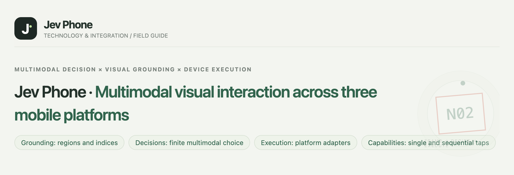
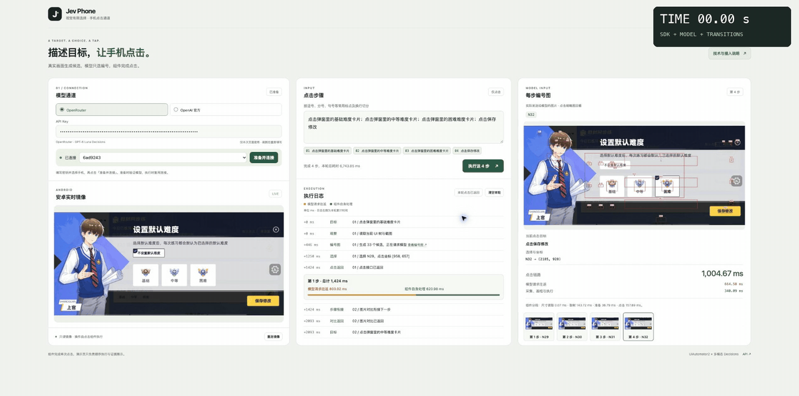
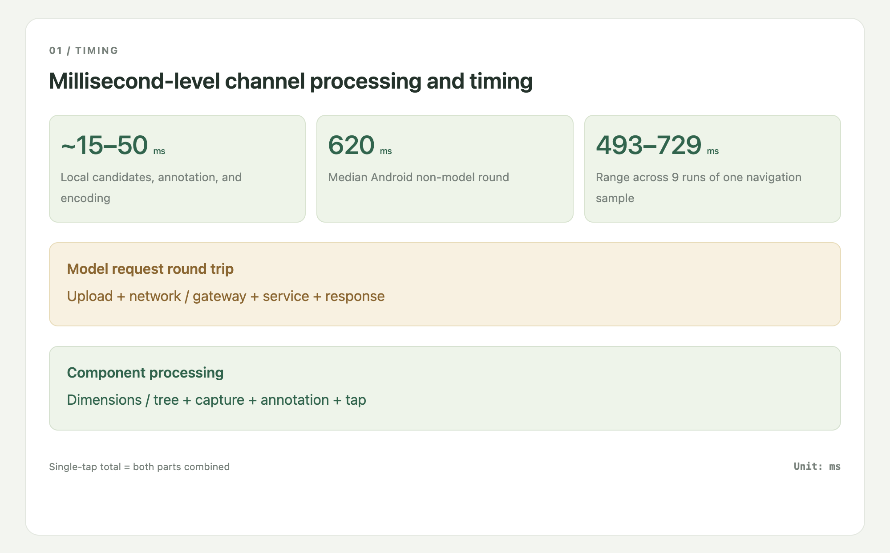
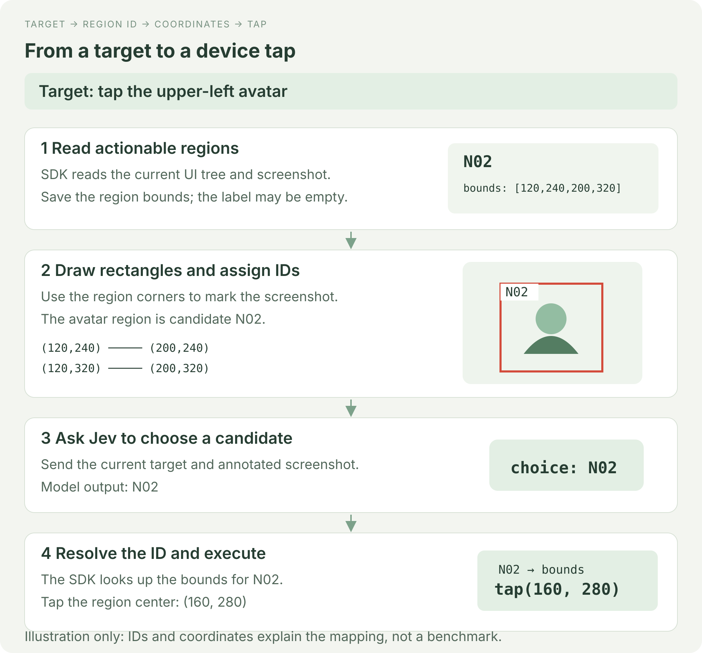
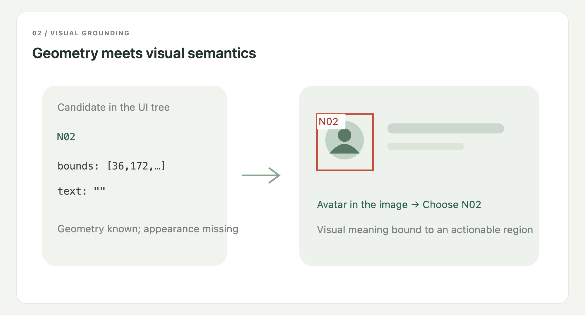
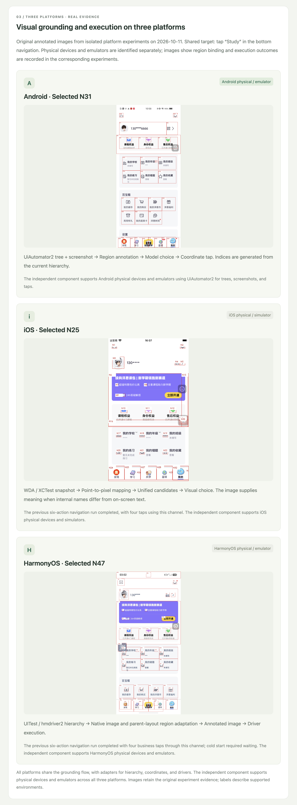

<h1 align="center">Jev Phone</h1>
<p align="center"><strong>A multimodal tap SDK for three mobile platforms, with millisecond-level local processing</strong></p>
<p align="center">Android · iOS · HarmonyOS</p>
<p align="center"><strong>Economical, fast, accurate</strong></p>
<p align="center"><a href="README.en.md">English</a> · <a href="README.md">中文</a></p>

Jev Phone connects Jev multimodal decisions to mobile devices, providing an independent tap component for existing agents, testing platforms, and scripts. **Your system supplies a target; the SDK locates it in the current screen and executes the tap.**

It handles the gap between knowing what to operate and acting on the device. Keep your own planner, cache, and business logic without importing the complete AI Phone framework.



## Real-device demo: preview and save difficulty

Four consecutive taps on a real Android device: Basic → Medium → Hard → Save. The difficulty dialog is already open at the start; Hard is saved at the end. The stopwatch follows real elapsed time; playback is not accelerated.



<table align="center">
<thead><tr><th align="center">Step</th><th align="center">Model round trip</th><th align="center">SDK local processing</th><th align="center">Page stability wait</th><th align="center">Complete step</th></tr></thead>
<tbody>
<tr><td align="center">Basic</td><td align="center">763.28 ms</td><td align="center">490.99 ms</td><td align="center">658.00 ms</td><td align="center">1,912.27 ms</td></tr>
<tr><td align="center">Medium</td><td align="center">646.39 ms</td><td align="center">289.80 ms</td><td align="center">665.00 ms</td><td align="center">1,601.19 ms</td></tr>
<tr><td align="center">Hard</td><td align="center">647.78 ms</td><td align="center">296.26 ms</td><td align="center">702.00 ms</td><td align="center">1,646.04 ms</td></tr>
<tr><td align="center">Save</td><td align="center">706.62 ms</td><td align="center">301.97 ms</td><td align="center">0.00 ms</td><td align="center">1,008.59 ms</td></tr>
</tbody>
</table>

Complete-step time includes waiting for the page to stabilize after the tap, using consecutive screenshots to detect stability. The final step has no following step and adds no stability wait. Step 1 is below 2 seconds; steps 2–4 are each below 1.7 seconds. Actual run time: **6,170.82ms**. Local SDK processing runs on a millisecond timescale; model round-trip latency depends on your network conditions and model-service response time, and is the main source of variation in complete-step timing.

[MP4](docs/media/demo-default-difficulty-fast.mp4) · [JSON](docs/media/demo-default-difficulty-fast.json)

## Performance

Local candidate processing, annotation, and encoding took **15–50ms** in the existing Android experiment. The non-model round had a **620ms** median and a **493–729ms** range across nine runs of one navigation sample. These measurements exclude model requests, initialization, and screen settling.

Complete step time includes capture, candidate processing, the model round trip, the tap, and the transition following that step. [Full stage-by-stage records, Chinese](docs/演示耗时明细.md).



## How it works: Jev chooses, the SDK executes

The current multimodal Jev integration uses a **finite-choice decision interface**. It interprets the image and selects a supplied candidate; it does not directly return a device action or executable tap coordinates through this integration. The SDK therefore bridges the model's choice to an actual device operation.

The component obtains actionable element bounds from the UI tree, uses their four corners to draw rectangles on the screenshot, and assigns IDs. Jev receives the current target and annotated image and returns an ID. The SDK looks up that element, computes its center, and asks the platform driver to tap it. Bounds are stored as the upper-left and lower-right coordinates, which determine all four corners.



## Why combine the UI tree and screenshot?

The rectangle gets its geometry from the UI tree, while the screenshot supplies visible text, icons, and appearance. A node can have an empty label yet display an avatar. In that case, Jev identifies the avatar in the image and chooses its ID; the SDK uses the same ID to recover the known bounds. This binds a multimodal choice to an executable element.



## Platform support and device preparation

Three adapters are implemented: Android uses UiAutomator2, iOS uses WDA / XCTest, and HarmonyOS uses UITest / hmdriver2. They normalize hierarchies, screenshots, display dimensions, and taps into the same candidate-selection flow. iOS also maps screenshot pixels to WDA points. The SDK supports physical devices and emulators, with single and sequential taps through the same interface.

Before use, prepare an authorized, unlocked device and its platform service, along with the appropriate model credentials:

| Platform | Preparation |
|---|---|
| Android | ADB recognizes the device; USB debugging is authorized and UiAutomator2 can run. |
| iOS | Developer Mode and trust are configured on the physical device; a signed, running WDA service is reachable. |
| HarmonyOS | HDC recognizes the authorized device and UITest / hmdriver2 can access it. |

[Device preparation guide, Chinese](docs/三端设备准备.md). The original three-platform figures below show numbered regions and their execution binding.



## Independent SDK integration

Add phone taps to your existing program: prepare the device service and model credentials, create a Clicker for the target platform, then call `click(target)` for one tap or `run(text)` for a sequence. The SDK returns selected regions, coordinates, driver status, and stage timing so your system can continue its workflow.

No Demo webpage or database is required. Use `AndroidClicker`, `IOSClicker`, or `HarmonyClicker`; the detailed integration guide covers provider configuration and error handling.

[SDK guide, Chinese](docs/接入指南.md) · [Device setup, Chinese](docs/三端设备准备.md) · [Example](examples/click.py) · [Parallel devices](examples/parallel.py)

## Current scope and next integrations

The SDK currently supports single and sequential taps on Android, iOS, and HarmonyOS physical devices and emulators. It captures the screen, builds candidates, obtains a model choice, executes the tap, and returns results and timing.

Text input, scrolling, long press, and more gestures remain future extensions. Existing systems continue to provide planning, business assertions, app launch, and device scheduling, integrating them around the tap component.

[Version, upgrades and maintenance](docs/升级与维护.en.md) · Current version: **0.1.1**.

## Integration code

Python 3.10+. Install from the repository:

```sh
git clone https://github.com/dongxinsuperman/jev-phone.git
cd jev-phone
python3 -m venv .venv
.venv/bin/pip install -e '.[android]'
```

```python
from getpass import getpass
from jev_phone import AndroidClicker

with AndroidClicker(
    serial="YOUR_DEVICE_SERIAL",
    api_key=getpass("OpenRouter Key: "),
    provider="openrouter",
) as phone:
    report = phone.run("Open default difficulty settings; select medium difficulty; save changes")
    print(report["results"])
```

[SDK guide, Chinese](docs/接入指南.md) · [Device setup, Chinese](docs/三端设备准备.md) · [Validation, Chinese](docs/验证概览.md) · [Full timing records, Chinese](docs/演示耗时明细.md) · [Page source](docs/readme-site/manual.en.html) · [MIT](LICENSE)
