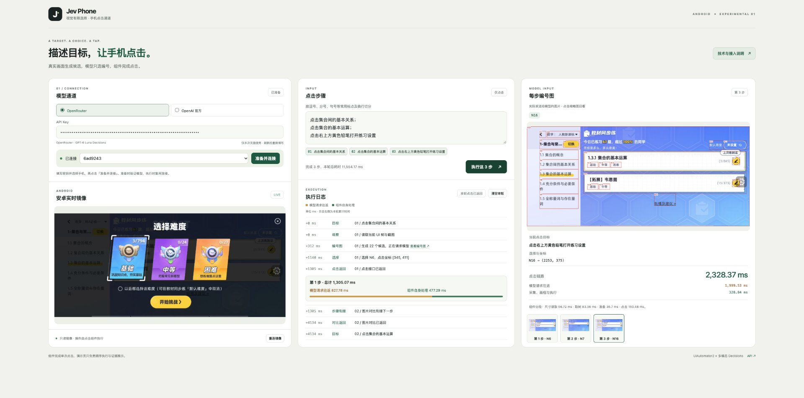

<h1 align="center">Jev Phone</h1>
<p align="center"><strong>A multimodal tap SDK for three mobile platforms, with millisecond-level local processing</strong></p>
<p align="center">Android · iOS · HarmonyOS<br>Physical devices and emulators · Single and sequential taps · Python · MIT</p>
<p align="center"><a href="README.en.md">English</a> · <a href="README.md">中文</a></p>

Jev Phone connects Jev multimodal decisions to mobile devices, providing an independent tap component for existing agents, testing platforms, and scripts. **Your system supplies a target; the SDK locates it in the current screen and executes the tap.**

It handles the gap between knowing what to operate and acting on the device. Keep your own planner, cache, and business logic without importing the complete AI Phone framework.

<!-- Two demonstration GIFs belong here only after every complete step is <=1700ms. -->

[](docs/media/demo-home-hd.jpg)

[](docs/media/website-guide.en.png)

## Current scope and next integrations

The SDK currently supports single and sequential taps on Android, iOS, and HarmonyOS physical devices and emulators. It captures the screen, generates candidates, obtains a model choice, executes the tap, and returns results and timing.

Text input, scrolling, long press, and more gestures remain future extensions. Existing systems continue to provide task planning, business assertions, app launch, and device scheduling; these capabilities can be integrated around the tap SDK.

## Integration code

Python 3.10+. Install from the repository:

```sh
git clone https://github.com/dongxinsuperman/jev-phone.git
cd jev-phone
python3 -m venv .venv
.venv/bin/pip install -e '.[android]'
```

```python
from getpass import getpass
from jev_phone import AndroidClicker

with AndroidClicker(
    serial="YOUR_DEVICE_SERIAL",
    api_key=getpass("OpenRouter Key: "),
    provider="openrouter",
) as phone:
    report = phone.run("Open default difficulty settings; select medium difficulty; save changes")
    print(report["results"])
```

[SDK guide, Chinese](docs/接入指南.md) · [Device setup, Chinese](docs/三端设备准备.md) · [Validation, Chinese](docs/验证概览.md) · [Full timing records, Chinese](docs/演示耗时明细.md) · [Page source](docs/readme-site/manual.en.html) · [MIT](LICENSE)
