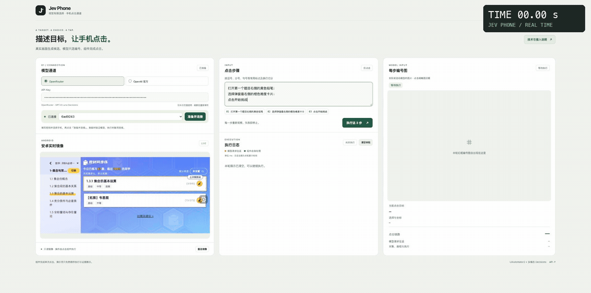
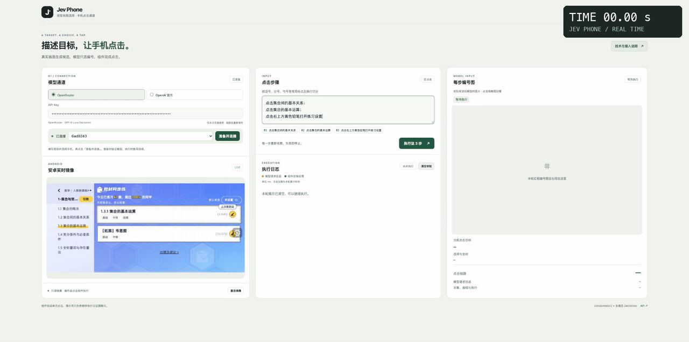
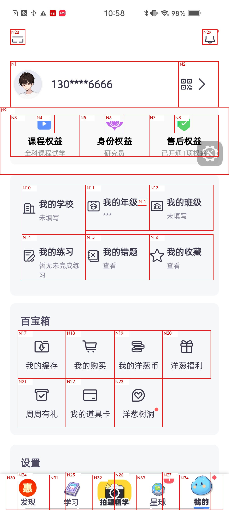
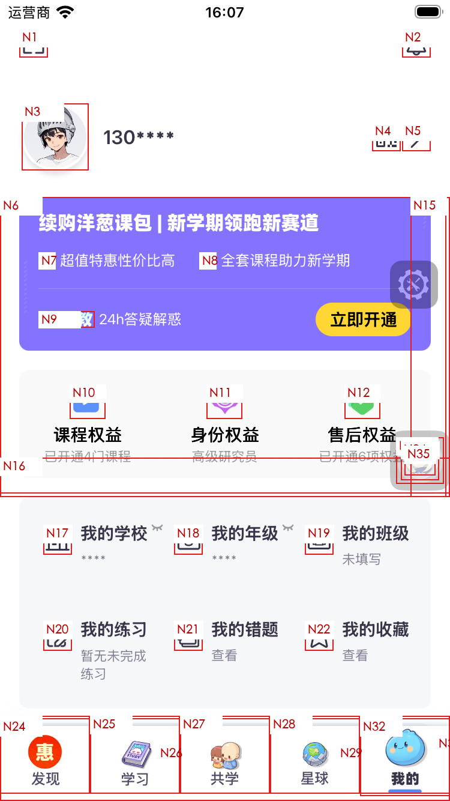
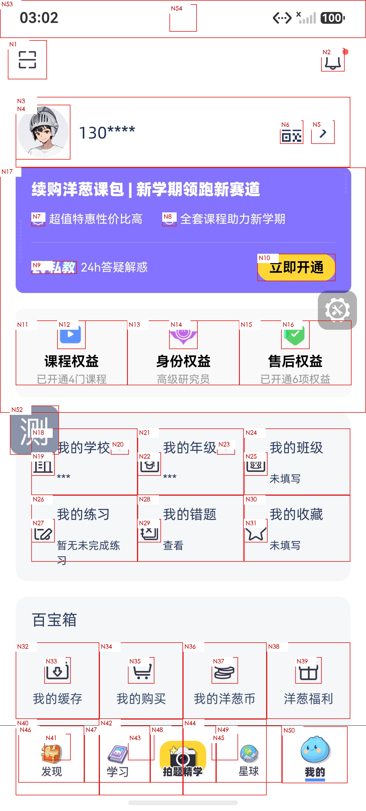
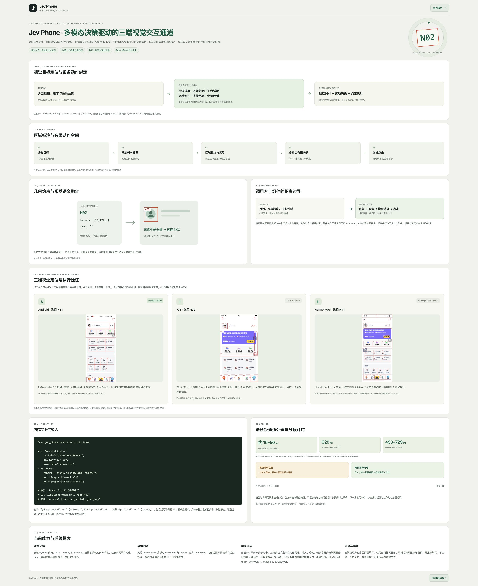

# Jev Phone

**多模态决策驱动的三端视觉交互通道。**

Jev Phone 把语义点击目标绑定到手机画面中的可执行区域，供已有 AI、任务系统和自动化脚本作为独立 Python SDK 接入。调用方给出目标与顺序，组件完成视觉定位、模型选择和设备点击，并返回每一步的结果。

<p align="center"><b>Android · iOS · HarmonyOS</b>　／　真机 · 虚拟机<br>独立 Python SDK · 单步与多步点击 · MIT 开源</p>

<p align="center"><a href="#执行演示">执行演示</a> · <a href="#核心能力">核心能力</a> · <a href="#技术与接入说明">技术与接入说明</a> · <a href="#安装与调用">快速接入</a></p>

## 执行演示

### 选择难度并开始挑战

下面使用真实安卓手机，连续完成三个操作：打开练习设置、选择最右侧橙色困难卡片、开始挑战。最终进入困难题目。



三个步骤的模型请求往返分别为 **1944.83ms、1025.65ms、765.28ms**。整段执行 **6.57 秒**，包含截图、候选生成、模型请求、点击及步骤间图片对比；视频原速播放，右上角秒表显示累计执行时间。

[观看视频](docs/media/demo-hard-challenge.mp4) · [计时记录](docs/media/demo-hard-challenge.json)

### 浏览章节并打开练习设置

依次点击“集合间的基本关系”和“集合的基本运算”，再点击右上方黄色铅笔打开练习设置。每一步只向模型传入当前操作目标。



三个步骤的模型请求往返分别为 **827.78ms、693.05ms、1999.53ms**。上述两段演示的每步模型请求均低于2秒；这个数值不包含设备采集、点击和步骤衔接时间。[观看视频](docs/media/demo-section-switch.mp4) · [计时记录](docs/media/demo-section-switch.json)

## 核心能力

**把“要点什么”转成“当前画面中点哪里”，并完成这次点击。**

| 核心 | 具体怎么做 |
|---|---|
| 视觉目标与设备动作绑定 | 系统树提供区域边界，截图提供文字、图标和外观语义；两者共同生成带编号的候选。模型选择编号，SDK 将编号绑定到当帧坐标并执行。 |
| 多模态有限选择 | 模型在当前候选中选择，返回编号、未找到或不确定。每步只发送当前目标、候选属性和编号图。 |
| 三端统一调用 | Android、iOS、HarmonyOS 共用定位流程，通过平台适配处理层级、坐标与驱动差异，支持真机与虚拟机。 |
| 连续步骤执行 | 一段目标按中英文标点与换行拆步，依次执行；步骤之间沿用 V3 已调好的图片对比参数，复用末帧。 |
| 可查看的执行过程 | 返回候选图、模型选择、坐标、驱动回执和分段耗时。Demo 调用同一 SDK，将这些结果直接呈现出来。 |

### 用它来做什么

将它接到你已有的 Agent、Planner、测试流程或脚本中，承接其中的手机点击环节。你决定业务目标、步骤顺序和业务结果如何判断；Jev Phone 负责当前画面的目标定位与点击执行。外部规划与缓存可以继续使用，不需要搬入 AI Phone 框架，也不需要运行 Demo 网页。

当前交付重点是 **独立、可接入的三端单步与多步点击组件**。下面完整保留官网的演示界面和技术说明原图，展示区域标注、动作绑定、三端适配、职责边界及分段计时。

## 演示界面

Demo 使用同一套 SDK，展示手机实时镜像、逐步执行日志，以及实际发送给模型的编号图。每步可以查看选中区域、点击坐标和分段耗时；网页演示目前使用安卓设备。


## 技术与接入说明

候选编号绑定当前画面的区域，模型在有限候选中选择，SDK 负责坐标映射与平台点击。多步执行时，通过图片对比衔接下一步并复用末帧。三端共用定位流程，分别适配 UiAutomator2、WDA 与 UITest；SDK 不依赖演示网页或 AI Phone 框架。

### 三端视觉定位与执行

三端真机／虚拟机均已贯通。下面分别展开官网中的原始编号图，点击图片可查看原始分辨率；图中记录的是各自实验时的候选编号。

#### Android · 真机／虚拟机

UiAutomator2 系统树与截图生成候选区域，模型选择 **N31**，再映射为坐标点击。

<p align="center"><a href="docs/media/android-grounding.png"></a></p>

#### iOS · 真机／虚拟机

WDA / XCTest 提供层级，适配 point 与截图 pixel 坐标；模型依据画面选择 **N25**。

<p align="center"><a href="docs/media/ios-grounding.png"></a></p>

#### HarmonyOS · 真机／虚拟机

UITest / hmdriver2 提供层级，经平台区域适配生成编号图；模型选择 **N47**，由驱动执行。

<p align="center"><a href="docs/media/harmony-grounding.png"></a></p>

三张原图分别来自安卓真机、iOS虚拟机和鸿蒙虚拟机的既有实验；标题标明当前组件支持的设备范围。

### 官网技术说明全图



## 安装与调用

Python 3.10+。从仓库安装，尚未发布到 PyPI。

```sh
git clone https://github.com/dongxinsuperman/jev-phone.git
cd jev-phone
python3 -m venv .venv
.venv/bin/pip install -e '.[android]'
```

```python
from getpass import getpass
from jev_phone import AndroidClicker

with AndroidClicker(
    serial="YOUR_DEVICE_SERIAL",
    api_key=getpass("OpenRouter Key: "),
) as phone:
    report = phone.run("打开练习设置；选择困难；点击开始挑战")
    print(report["results"])
```

Android、iOS、HarmonyOS · 真机／虚拟机。Demo 与独立 SDK 使用同一执行流程。

[SDK 接入指南](docs/接入指南.md) · [三端设备准备](docs/三端设备准备.md) · [验证概览](docs/验证概览.md) · [调用示例](examples/click.py) · [多设备并行](examples/parallel.py)

[MIT 许可证](LICENSE) · [来源说明](NOTICE.md)
