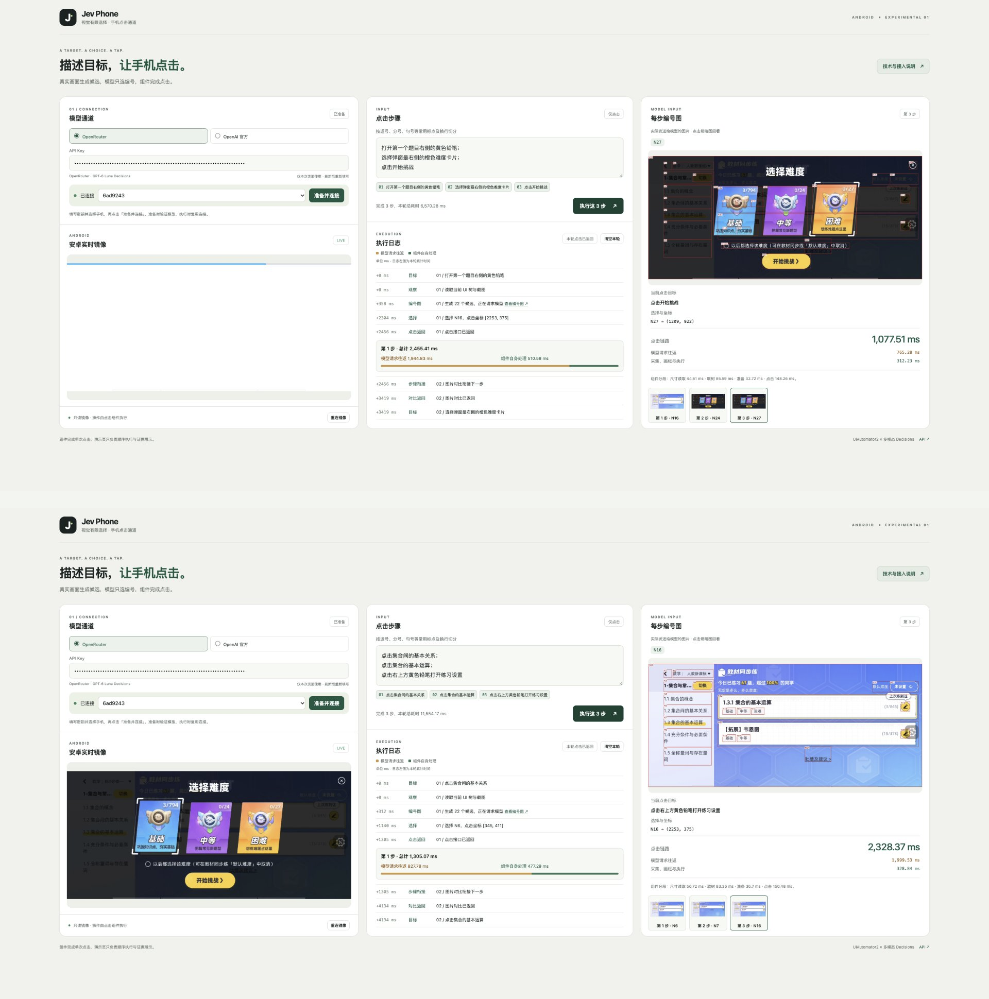

<h1 align="center">Jev Phone</h1>
<p align="center"><strong>毫秒级本地处理的三端多模态点击 SDK</strong></p>
<p align="center">Android · iOS · HarmonyOS<br>真机与虚拟机 · 单步与连续点击 · Python · MIT</p>
<p align="center"><a href="README.md">中文</a> · <a href="README.en.md">English</a></p>

Jev Phone 将 Jev 多模态决策接到三端设备上，为已有 Agent、测试平台和脚本提供可独立调用的手机点击能力。**调用方给出点击目标，SDK 完成当前画面的定位和执行。**

它承接从“知道要操作什么”到“实际点到设备上”的这一段。你可以继续使用自己的任务规划、缓存和业务判断，不需要引入完整 AI Phone 框架。

<!-- Two demonstration GIFs belong here only after every complete step is <=1700ms. -->

[](docs/media/demo-views-hd.png)

[](docs/media/website-guide.zh.png)

## 接入代码

Python 3.10+。从仓库安装：

```sh
git clone https://github.com/dongxinsuperman/jev-phone.git
cd jev-phone
python3 -m venv .venv
.venv/bin/pip install -e '.[android]'
```

```python
from getpass import getpass
from jev_phone import AndroidClicker

with AndroidClicker(
    serial="YOUR_DEVICE_SERIAL",
    api_key=getpass("OpenRouter Key: "),
    provider="openrouter",
) as phone:
    report = phone.run("打开默认难度设置；选择中等难度；保存修改")
    print(report["results"])
```

[SDK接入指南](docs/接入指南.md) · [三端设备准备](docs/三端设备准备.md) · [验证概览](docs/验证概览.md) · [完整计时记录](docs/演示耗时明细.md) · [页面源码](docs/readme-site/manual.zh.html) · [MIT](LICENSE)
