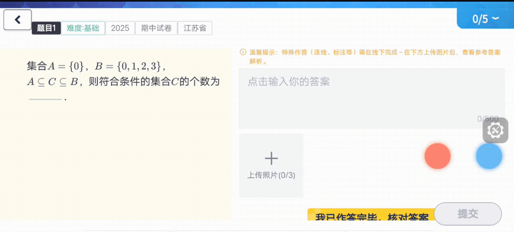

<p align="center"></p>

<p align="center"><b>独立 Python SDK</b> · 三端真机／虚拟机 · 单步与多步点击 · 当前版本 0.1.0</p>
<p align="center"><a href="#开始使用">开始使用</a> · <a href="#它怎样工作">执行流程</a> · <a href="#三端接入">三端接入</a> · <a href="#体验-demo">体验 Demo</a></p>

## 让模型选编号，让设备完成点击

Jev Phone 把已经明确的语义点击目标，绑定到当前设备画面中的可执行区域。系统树提供几何位置，截图补充视觉语义；模型只在当帧编号、`NOT_FOUND` 和 `UNCERTAIN` 中选择，平台驱动完成坐标点击。

你可以只调用一步，也可以提交一段内容。SDK 按标点和换行拆步，每一步只请求当前目标，沿用 V3 已调的图片对比衔接，执行到完成或失败停止。外部 AI、Planner、脚本和业务系统都可以接入，不依赖 AI Phone、数据库或网页。

### 点击通道的实际画面



*来自本地既有 AI Phone / Jev 集成实验的视频，裁出手机操作区域；原速播放。本片展示实际操作过程，不是独立 SDK 的速度基准。*

## 它怎样工作


**整段输入 → 符号拆步 → 当前目标定位与点击 → 图片对比衔接 → 下一步。**


树给出区域，画面表达外观，编号将模型选择绑定到可执行坐标。编号每步重新生成；模型不接收整段任务或之前步骤。

## 开始使用

需要 Python 3.10+。克隆仓库后安装（也可使用交付包）：

```sh
git clone https://github.com/dongxinsuperman/jev-phone.git
cd jev-phone
python3 -m venv .venv
.venv/bin/pip install -e '.[android]'
```

```python
from getpass import getpass
from jev_phone import AndroidClicker, RunFailure

with AndroidClicker("YOUR_ADB_SERIAL", getpass("OpenRouter Key: ")) as phone:
    try:
        report = phone.run("点击显示与亮度；点击护眼模式")
        print(report["results"])
        print(report["transitions"])
    except RunFailure as error:
        print(error.report)  # 已完成结果、失败步骤；后续不执行
```

只需一步时，使用 `phone.click("点击显示与亮度")`。`run()` 按中英文逗号、分号、句号、问号、感叹号和换行机械切分，最多20步；每段只表达一个点击目标。标点位于目标名字内部时也会切分。

## 三端接入

| 平台 | 真机／虚拟机 | 安装 | 调用入口 |
|---|---|---|---|
| Android | 均已贯通 | `pip install -e '.[android]'` | `AndroidClicker(serial, api_key)` |
| iOS | 均已贯通 | `pip install -e .` | `IOSClicker(wda_url, api_key)` |
| HarmonyOS | 均已贯通 | `pip install -e '.[harmony]'` | `HarmonyClicker(serial, api_key)` |

<table><tr><th>Android · 真机／虚拟机</th><th>iOS · 真机／虚拟机</th><th>HarmonyOS · 真机／虚拟机</th></tr><tr><td align="center"></td><td align="center"></td><td align="center"></td></tr></table>

*沿用 Demo 的三张原始编号图，不改图；图片分别来自安卓真机、iOS虚拟机、鸿蒙虚拟机的历史实验。平台标题表示当前 SDK 已贯通的支持范围。*

安卓准备 ADB / UiAutomator2，iOS 由使用者准备 WDA，鸿蒙准备 HDC / UITest。SDK 不管理签名、设备池和虚拟机生命周期。详细步骤见 [三端设备准备](docs/三端设备准备.md)。

### 不同设备同时执行

```sh
.venv/bin/pip install -e '.[android,harmony]'
.venv/bin/python examples/parallel.py examples/devices.json
```

修改配置中的设备编号、WDA地址和目标序列。不同设备并行，同设备按顺序执行；每台设备的候选、画面和结果独立。同进程的同设备调用共享锁，跨进程设备占用由接入方协调。

## 为每一步保留清楚的结果

- `results`：目标、选中编号、截图像素坐标、平台、设备和分段耗时。
- `transitions`：步骤间图片对比耗时、采样次数与返回状态。
- `on_event`：观察、编号图、选择、点击返回和步骤衔接事件。
- `RunFailure.report`：保留已完成结果与失败步骤，停止后续执行。

图片对比参数沿用 V3：安卓100ms、鸿蒙0ms、iOS200ms额外采样间隔。稳定末帧直接用于下一步，不重复截图，不在每步结束后追加展示截图。模型请求往返与组件自身处理分别计时，整段耗时包含步骤衔接。

## 体验 Demo

Demo 是 SDK 的一个使用者，保留安卓只读镜像、输入、逐步日志与实际模型编号图。外部程序使用 SDK 无需启动 Demo。

```sh
.venv/bin/pip install -e '.[demo]'
.venv/bin/jev-phone-demo
```

打开 `http://127.0.0.1:8765/`，选择安卓设备、填写 Key，点击“准备并连接”。Demo 镜像需要本机已有 `adb`、`scrcpy`、`ffmpeg`。右上角“技术与接入说明”展示组件结构与接入方式。

模型支持 OpenRouter 多模态 Decisions 和 OpenAI 官方 Decisions；用 `provider="openai"` 选择官方通道，两种 Key 不可混用。Demo 刷新后清除 Key 和模型连接；SDK 示例从环境变量或终端隐藏输入获取 Key，不随代码分发。

## 接入资料

- [SDK 接入指南](docs/接入指南.md)：公开接口、事件、计时、结果与失败处理。
- [三端设备准备](docs/三端设备准备.md)：ADB、WDA、HDC 环境与连接。
- [验证概览](docs/验证概览.md)：六种设备组合与当前能力范围。
- [单设备示例](examples/click.py)、[并行示例](examples/parallel.py)、[配置样例](examples/devices.json)。

当前提供点击能力；输入、滚动及其他手势由接入方扩展。`driver_completed` 表示点击驱动返回，业务判断仍由调用方完成。

开源仓库：[dongxinsuperman/jev-phone](https://github.com/dongxinsuperman/jev-phone)。许可证：[MIT](LICENSE)，来源说明见 [NOTICE](NOTICE.md)。当前尚未发布到 PyPI，请从源码或本地 wheel 安装。
