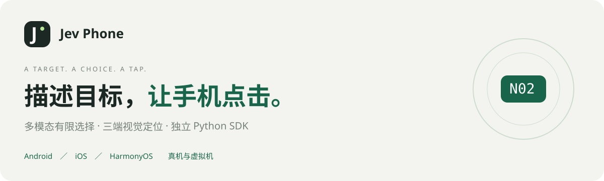
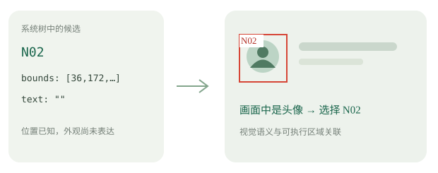

# Jev Phone

**多模态决策驱动的三端视觉交互通道。**


**当前 Demo 首页，真实安卓手机，原速连续执行。** 打开练习设置 → 选择最右侧橙色“困难”卡片 → 开始挑战。右上角秒表按原始页面帧时间戳计时，执行期间没有加速或删等待；最终题目确认显示“难度：困难”。

| 当前步骤 | 模型识别请求往返 |
|---|---:|
| 打开练习设置 | **1944.83ms** |
| 选择橙色困难卡片 | **1025.65ms** |
| 开始挑战 | **765.28ms** |

三个步骤的模型识别均低于2秒；整段执行6570.28ms，包含截图、点击及V3步骤衔接。录像保留完成后的短暂停留。[查看原速视频](docs/media/demo-hard-challenge.mp4) · [计时记录](docs/media/demo-hard-challenge.json)

<p align="center"></p>

<p align="center"><b>Android · iOS · HarmonyOS</b>　／　<b>真机 · 虚拟机</b><br>独立 Python SDK　·　单步与多步点击　·　MIT 开源</p>

<p align="center"><a href="#第一页--描述目标让手机点击">点击演示</a> · <a href="#第二页--技术与接入说明">技术与接入说明</a> · <a href="#05--独立组件接入">安装与调用</a> · <a href="#06--毫秒级通道处理与分段计时">毫秒计时</a></p>

---

# 第一页 / 描述目标，让手机点击。

**A TARGET. A CHOICE. A TAP.**

真实画面生成候选，模型只选编号，组件完成点击。


### 另一个实际例子：浏览章节并打开设置


“看看集合间的基本关系 → 转到集合的基本运算 → 打开练习设置”。三步模型识别分别827.78、693.05、1999.53ms，均低于2秒；保留完整图片对比衔接。[原速视频](docs/media/demo-section-switch.mp4) · [计时记录](docs/media/demo-section-switch.json)

这一页把一条点击链路直接展开给你看：连接手机和模型 → 输入目标 → 查看实际手机画面 → 查看每步编号图、模型选择、坐标与耗时。右上角“技术与接入说明”翻到下面的技术页。

## 01 / CONNECTION · 模型通道

支持 **OpenRouter 多模态 Decisions** 与 **OpenAI 官方 Decisions**，通过协议适配归一化模型结果。

选择通道、填写对应 API Key、选择安卓设备，点击“准备并连接”。准备阶段验证模型通道，执行阶段复用设备服务和模型客户端。

- OpenRouter：`openai/gpt-6-luna-decisions`。
- OpenAI 官方：`gpt-6-luna`，调用时使用 `provider="openai"`。
- Key 仅在本次页面中使用，密码掩码展示；刷新后清除连接与密钥，需重新填写。

## ANDROID · 安卓实时镜像

真实手机画面与执行过程并排展示。镜像为只读视频通道，由 scrcpy 与 ffmpeg 承接；实际操作由 SDK 点击组件执行。

镜像与定位截图分工明确：镜像用于人查看，模型使用每步实际采集和标注的截图。当前网页体验端为安卓，SDK 同时提供三端接入。

## INPUT · 点击步骤

可以输入一段内容，按约定的中英文标点和换行拆成多个点击步骤：

```text
点击底部导航栏的星球；
点击底部导航栏的我的
```

**每一步只传当前这一句目标。** 不把整段任务、上一句或执行历史一起交给模型。当前步骤完成后，用图片对比衔接下一步，并复用对比返回的最后一帧；定位或点击失败停止后续步骤。对比到4秒预算仍未确认稳定时，沿用V3返回最后一帧继续，不额外拦截。


SDK 和 Demo 使用同一套执行流程。SDK 的 `run()` 接收整段内容，自动拆步、遍历执行并汇总结果；单步 `click()` 继续保留。

## EXECUTION · 执行日志

日志逐步展示：

| 阶段 | 你能看到什么 |
|---|---|
| 目标 | 当前这一句点击目标 |
| 观察 | 当前系统树与设备截图 |
| 编号图 | 本步生成的候选数量、实际发给模型的图片 |
| 选择 | 模型选中的编号及其绑定坐标 |
| 点击返回 | 平台驱动完成回执与单步耗时 |
| 步骤衔接 | 图片对比返回状态、采样次数与衔接耗时 |

日志左侧记录本轮累计毫秒；模型请求往返与组件自身处理分别计时。当前不再追加每步结束后的展示截图。

## MODEL INPUT · 每步编号图

**展示的是实际发送给模型的图片。** 每张图上的红框与编号来自当前系统层级，并绑定到对应区域。点击缩略图，可以回看该步的目标、选中编号、坐标与分段耗时。

三端图片见下方“视觉定位与执行验证”。这些图将视觉识别、有限选择与可执行位置放在同一帧中展示。

---

# 第二页 / 技术与接入说明

**MULTIMODAL DECISION × VISUAL GROUNDING × DEVICE EXECUTION**

## Jev Phone · 多模态决策驱动的三端视觉交互通道

通过区域标注、有限选项决策与平台驱动，将语义目标映射为 Android、iOS、HarmonyOS 设备上的点击操作。独立组件供外部系统接入，交互式 Demo 展示执行过程与实测证据。

| 视觉定位 | 决策 | 执行 | 当前能力 |
|---|---|---|---|
| 区域标注与索引 | 多模态有限选择 | 跨平台驱动适配 | 单步与多步点击 |

<details>
<summary><b>查看官网第二页的完整原貌</b></summary>


</details>

## CORE / 视觉目标定位与设备动作绑定

<table><tr><th>目标输入</th><th>视觉定位与执行组件</th><th>多模态决策与驱动执行</th></tr><tr><td><b>外部应用、脚本与任务系统</b><br><br>调用方提供语义点击目标，SDK 负责顺序执行。</td><td><b>层级采集 · 区域筛选 · 平台适配<br>区域索引 · 决策绑定 · 坐标映射</b><br><br>基于系统层级构建候选动作空间，以区域索引约束模型输出。</td><td><b>视觉识别 → 选项决策 → 点击执行</b><br><br>决策结果绑定当帧区域，由平台驱动执行坐标操作。</td></tr></table>

这条通道可以接入已有 AI、Planner、缓存或脚本。它承接已明确的点击目标；接在外部技术栈的哪个环节，由使用者决定。

模型协议为 OpenRouter 多模态 Decisions / OpenAI 官方 Decisions。当前实现使用多模态决策模型；TypeSafe Jev 的原生文本接口属于不同后端。

## 01 / 区域标注与有限动作空间

| 01 · 语义目标 | 02 · 系统树＋截图 | 03 · 区域标注与索引 | 04 · 多模态有限决策 | 05 · 坐标点击 |
|---|---|---|---|---|
| “点击左上角头像” | 观察当前设备状态 | 筛选候选区域，生成红框和编号 | `N02` / `NOT_FOUND` / `UNCERTAIN` | 编号映射到区域中心，由驱动执行 |

每步独立采集并生成区域索引。请求包含当前目标、候选属性和标注截图；设备服务与网络客户端持续复用。模型选择被限制在当前候选空间中，结果直接绑定到当前帧中的执行区域。

## 02 / 几何约束与视觉语义融合



系统节点提供几何区域与属性，截图补充文本、图标及外观语义。区域索引将视觉识别结果关联到可执行位置。

例如节点 `N02` 的文字可能为空，但画面中明确显示头像。树提供它的边界，模型依据画面识别头像并选择 `N02`，组件将这个选择映射成点击坐标。

这是结构示意；实际模型输入与执行结果在 Demo 中逐步展示。

## 03 / 调用方与组件的职责边界

| 调用方负责 | Jev Phone 负责 |
|---|---|
| 业务目标、目标顺序、业务判断 | 符号拆步、顺序执行、步骤衔接 |
| 应用逻辑、测试流程及任务编排 | 系统层级与截图采集、候选区域与编号 |
| 提供已准备好的设备服务与模型 Key | 多模态有限选择、坐标映射与平台点击 |
| 接收结果并组织自己的后续流程 | 返回事件、编号图、坐标和毫秒计时；失败停止 |

SDK 独立于演示界面和 AI Phone。Demo 是它的使用者；接入自己的程序不需要网页或数据库。

## 04 / 三端视觉定位与执行验证

**Android、iOS、HarmonyOS 的真机／虚拟机均已贯通。**

<table><tr><th>Android · 真机／虚拟机</th><th>iOS · 真机／虚拟机</th><th>HarmonyOS · 真机／虚拟机</th></tr><tr><td align="center"></td><td align="center"></td><td align="center"></td></tr><tr><td><b>Android · 选择 N31</b><br><br>UiAutomator2 系统树＋截图 → 区域标注 → 模型选择 → 坐标点击。区域索引根据当帧系统层级动态生成。</td><td><b>iOS · 选择 N25</b><br><br>WDA / XCTest 快照 → point 与截图 pixel 映射 → 统一候选 → 视觉选择。系统名称与画面文字不一致时，图像补充语义。</td><td><b>HarmonyOS · 选择 N47</b><br><br>UITest / hmdriver2 层级 → 图片子区域与父布局边界适配 → 编号图 → 驱动执行。</td></tr></table>

沿用官网三张原始编号图，图片不改。图片分别来自安卓真机、iOS 虚拟机、鸿蒙虚拟机的既有实验，共同目标为点击底部“学习”；平台标题表示当前 SDK 的真机／虚拟机支持范围。

三端共享定位流程，通过平台适配处理层级、坐标与驱动差异。完整环境准备见 [三端设备准备](docs/三端设备准备.md)，支持范围见 [验证概览](docs/验证概览.md)。

## 05 / 独立组件接入

### 安装

Python 3.10+，克隆仓库后按平台安装：

```sh
git clone https://github.com/dongxinsuperman/jev-phone.git
cd jev-phone
python3 -m venv .venv

# Android
.venv/bin/pip install -e '.[android]'

# iOS：连接你已准备好的 WDA
.venv/bin/pip install -e .

# HarmonyOS
.venv/bin/pip install -e '.[harmony]'
```

### 一段目标直接执行

```python
from getpass import getpass
from jev_phone import AndroidClicker, RunFailure

with AndroidClicker(
    serial="YOUR_DEVICE_SERIAL",
    api_key=getpass("OpenRouter Key: "),
    provider="openrouter",  # 官方通道填 openai
) as phone:
    try:
        report = phone.run("点击底部导航栏的星球；点击底部导航栏的我的")
        print(report["results"])
        print(report["transitions"])
    except RunFailure as error:
        print(error.report)
```

单步调用：`phone.click("点击底部的我的")`。iOS 使用 `IOSClicker(wda_url, api_key)`；鸿蒙使用 `HarmonyClicker(hdc_serial, api_key)`。

`run()` 按中英文逗号、分号、句号、问号、感叹号及换行机械拆步，最多20步。每段只描述一个点击目标；支持采集、编号图、模型选择、点击返回与步骤衔接事件，使用 `on_event` 接收。

### 多设备并行

```sh
.venv/bin/pip install -e '.[android,harmony]'
.venv/bin/python examples/parallel.py examples/devices.json
```

配置设备编号、WDA地址及每台设备的目标序列。不同设备并行，同设备顺序执行；每台设备的截图、候选和结果独立。公开调用方式、返回字段及失败处理见 [SDK 接入指南](docs/接入指南.md)。

## 06 / 毫秒级通道处理与分段计时

官网记录了前期安卓常驻 UiAutomator2 实验的毫秒级处理数据：

| 本地候选处理、画框与编码 | 安卓非模型整轮实测中位 | 同一导航样本9轮范围 |
|---|---|---|
| **约15–50ms** | **620ms** | **493–729ms** |

这组数据不含模型请求、初始化与步骤稳定衔接；是对应实验的记录。首屏秒表实录直接展示当前独立 SDK 和 Demo 的模型定位、步骤衔接与连续点击节奏。

<table><tr><th>模型请求往返</th><th>组件自身处理</th></tr><tr><td>上传＋网络／网关＋服务处理＋返回</td><td>尺寸／树＋按需截图＋候选画框＋点击</td></tr></table>

**单步总时间 = 模型请求往返 + 组件自身处理。单位均为 ms。**

整段执行另记录步骤间图片对比的耗时、采样次数和状态。不逐步追加结束后截图；下一步直接复用对比末帧。

| 平台 | 已对齐的截图／取树／点击通道 | 对比额外采样间隔 |
|---|---|---|
| Android | UiAutomator2 原生 JPEG、实时显示尺寸、原生树与坐标点击 | **100ms** |
| iOS | WDA 按需截图、XCTest 文字区域与控件候选、pixel/point 映射、临时缩短点击内部等待并恢复 | **200ms** |
| HarmonyOS | 原生 JPEG、UITest `captureLayout` 直返树、直接点击完成回执 | **0ms** |

0ms 指不添加采样 sleep，截图本身仍有耗时。客户端空闲连接有效期60秒；模型与网络、页面和设备负载影响实际端到端耗时。

## 07 / 当前能力与实践约定

### 运行环境

SDK 是独立 Python 包。安卓准备 ADB / UiAutomator2，iOS 提供已有 WDA 地址，鸿蒙准备 HDC / UITest；真机与虚拟机共用平台适配。WDA签名、设备池和虚拟机生命周期由使用者准备。

### 模型通道

支持 OpenRouter 多模态 Decisions 与 OpenAI 官方 Decisions，适配不同的请求／返回协议，归一化有限选择结果。对应 Key 不可混用。

### 明确边界

当前交付单步与多步点击，三端真机／虚拟机均已贯通。输入、滚动、长按等动作可由使用者二次开发。业务判断由调用方完成；`driver_completed` 表示平台驱动返回。

### 证据与密钥

Demo 的 Key 仅在当前页面使用，刷新后清除。SDK 示例从环境变量或隐藏终端输入获取 Key。截图与执行记录保存为本地产物，不把 Key、原始日志或个人设备配置上传仓库。

## 启动官网 Demo

```sh
.venv/bin/pip install -e '.[demo]'
.venv/bin/jev-phone-demo
```

本机准备 `adb`、`scrcpy`、`ffmpeg`，打开 `http://127.0.0.1:8765/`。选择手机与模型通道，填写 Key，准备连接后输入点击步骤。网页提供安卓只读实时镜像、日志与编号图；SDK 三端调用不依赖这个网页。

## 接入资料与开源

- [SDK 接入指南](docs/接入指南.md)
- [三端设备准备](docs/三端设备准备.md)
- [验证概览](docs/验证概览.md)
- [单设备示例](examples/click.py) · [并行示例](examples/parallel.py) · [配置样例](examples/devices.json)
- [MIT 许可证](LICENSE) · [来源说明](NOTICE.md)

Jev Phone · 多模态有限决策、视觉定位与跨平台动作绑定。当前从 GitHub 源码或 wheel 安装，尚未发布到 PyPI。
