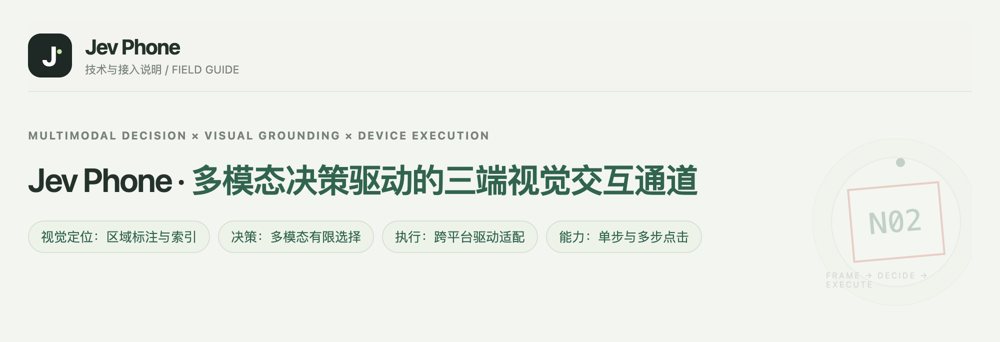
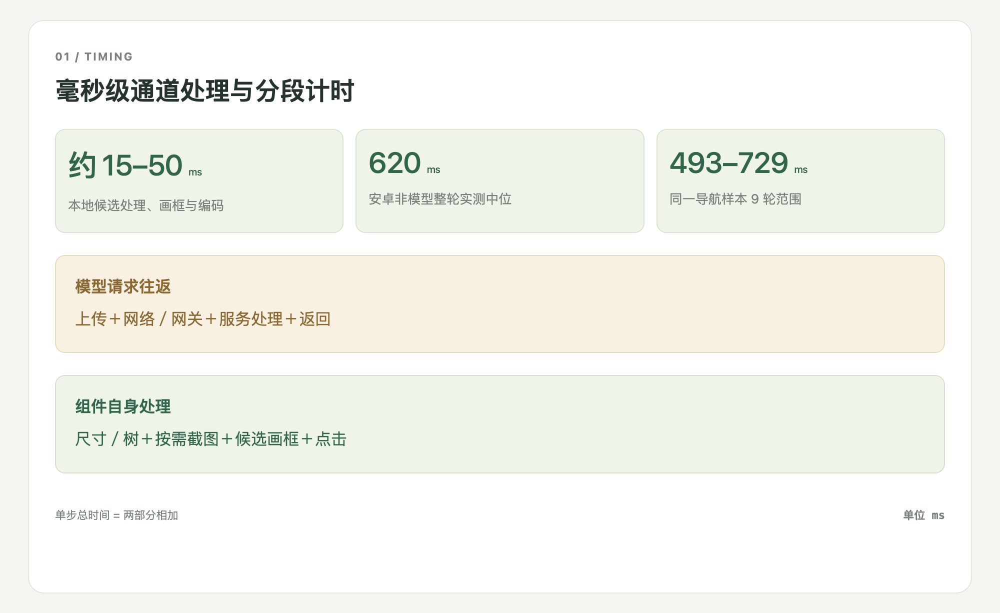
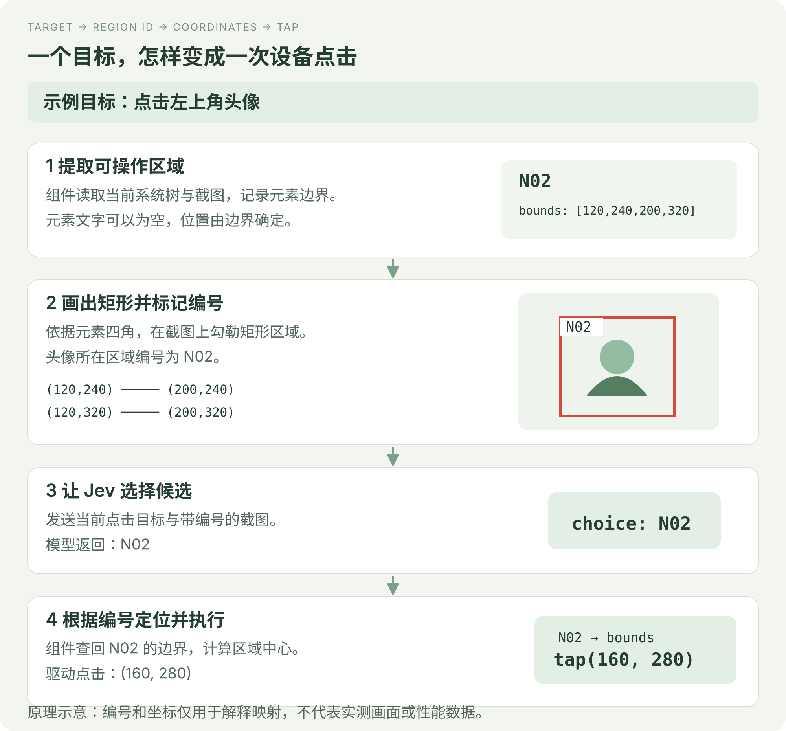
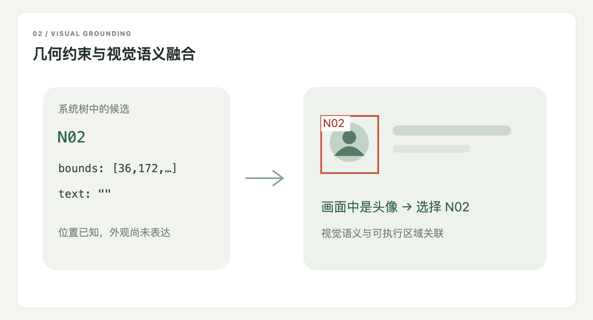
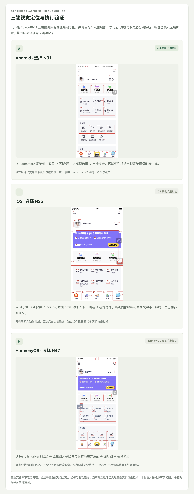

<h1 align="center">Jev Phone</h1>
<p align="center"><strong>毫秒级本地处理的三端多模态点击 SDK</strong></p>
<p align="center">Android · iOS · HarmonyOS<br>真机与虚拟机 · 单步与连续点击 · Python · MIT</p>
<p align="center"><a href="README.md">中文</a> · <a href="README.en.md">English</a></p>

Jev Phone 将 Jev 多模态决策接到三端设备上，为已有 Agent、测试平台和脚本提供可独立调用的手机点击能力。**调用方给出点击目标，SDK 完成当前画面的定位和执行。**

它承接从“知道要操作什么”到“实际点到设备上”的这一段。你可以继续使用自己的任务规划、缓存和业务判断，不需要引入完整 AI Phone 框架。

<!-- Two demonstration GIFs belong here only after every complete step is <=1700ms. -->

[](docs/media/demo-home-hd.jpg)



## 性能

已有安卓实验中，本地候选处理、画框与编码耗时 **15–50ms**；非模型整轮中位为 **620ms**，同一导航样本9轮范围为 **493–729ms**。这些数据不包含模型请求、初始化与页面稳定。

每一步整体耗时还包括设备采集、候选处理、模型往返、点击和该步后续衔接。[完整分段记录](docs/演示耗时明细.md)分别列出这些时间。



## 工作原理：Jev 选择，组件执行

当前接入的多模态 Jev 采用 **有限选项决策接口**：它结合图像选择给定候选，这种接入方式并不直接返回设备操作指令或可执行的点击坐标。因此，从模型选中目标到设备实际点击，还需要组件完成定位与动作绑定。

我们先从系统树中提取可操作元素的边界，用四角在截图上勾勒出矩形，并为每个区域标记编号。Jev 接收当前目标和带编号的图像，只需选出对应编号；组件再根据编号找回元素边界，计算中心坐标，交给平台驱动执行点击。代码保存左上角与右下角坐标，由此确定矩形四角。



## 为什么结合系统树与截图

矩形的位置来自系统树，目标的文字、图标和外观语义来自截图。例如，节点文字为空，但画面中显示的是头像：Jev 可以依据图像识别头像并选择它的编号，组件则用同一编号找回已知边界。这样，多模态选项决策就能对应到真实可操作元素，而不需要模型自己生成坐标。



## 三端支持与设备准备

目前已完成三端适配：安卓使用 UiAutomator2，iOS 使用 WDA / XCTest，鸿蒙使用 UITest / hmdriver2。组件把各端的系统层级、截图、显示尺寸与点击通道接入同一候选定位流程，并处理 iOS 截图像素与 WDA point 的坐标映射。三端均支持真机与虚拟机，使用同一接口完成单步和连续点击。

使用前，需要准备已授权、保持解锁的设备及对应平台服务，再提供所选模型通道的 Key：

| 平台 | 需要准备 |
|---|---|
| Android | ADB 能识别设备，USB 调试已授权，UiAutomator2 服务可运行。 |
| iOS | 真机已开启开发者模式并完成信任，签名后的 WDA 服务已运行且地址可访问。 |
| HarmonyOS | HDC 能识别并连接已授权设备，UITest / hmdriver2 服务可用。 |

具体操作见[三端设备准备](docs/三端设备准备.md)。下面保留三端原始图例，展示候选编号与可执行区域的绑定。



## 独立组件接入

把手机点击能力接到你已有的程序中：准备好设备服务和模型 Key，创建目标平台的 Clicker。单个点击目标调用 `click(target)`，一组有序目标调用 `run(text)`；组件返回选中区域、坐标、驱动状态和分段耗时，让你的程序继续处理后续流程。

接入不需要运行 Demo 网页或数据库。安卓、iOS、鸿蒙分别使用 `AndroidClicker`、`IOSClicker`、`HarmonyClicker`，模型通道配置和异常处理见接入指南。

[SDK接入指南](docs/接入指南.md) · [三端设备准备](docs/三端设备准备.md) · [调用示例](examples/click.py) · [多设备并行](examples/parallel.py)

## 当前能力与后续承接

当前支持 Android、iOS、HarmonyOS 真机与虚拟机上的单步和连续点击，完成画面采集、候选生成、模型选择、点击执行，并返回结果与计时。

后续可扩展输入、滚动、长按等动作。任务规划、业务断言、应用启动和设备调度由现有系统承接，可以围绕点击组件继续集成。

## 接入代码

Python 3.10+。从仓库安装：

```sh
git clone https://github.com/dongxinsuperman/jev-phone.git
cd jev-phone
python3 -m venv .venv
.venv/bin/pip install -e '.[android]'
```

```python
from getpass import getpass
from jev_phone import AndroidClicker

with AndroidClicker(
    serial="YOUR_DEVICE_SERIAL",
    api_key=getpass("OpenRouter Key: "),
    provider="openrouter",
) as phone:
    report = phone.run("打开默认难度设置；选择中等难度；保存修改")
    print(report["results"])
```

[SDK接入指南](docs/接入指南.md) · [三端设备准备](docs/三端设备准备.md) · [验证概览](docs/验证概览.md) · [完整计时记录](docs/演示耗时明细.md) · [页面源码](docs/readme-site/manual.zh.html) · [MIT](LICENSE)
