<h1 align="center">Jev Phone</h1>
<p align="center"><strong>毫秒级本地处理的三端多模态点击 SDK</strong></p>
<p align="center">Android · iOS · HarmonyOS<br>真机与虚拟机 · 单步与连续点击 · Python · MIT</p>
<p align="center"><a href="README.md">中文</a> · <a href="README.en.md">English</a> · <a href="#快速接入">快速接入</a> · <a href="#工作原理">工作原理</a> · <a href="#性能与计时">性能与计时</a></p>

Jev Phone 将 Jev 多模态决策接到三端设备上，为已有 Agent、测试平台和脚本提供可独立调用的手机点击能力。**调用方给出点击目标，SDK 完成当前画面的定位和执行。**

它承接从“知道要操作什么”到“实际点到设备上”的这一段。你可以继续使用自己的任务规划、缓存和业务判断，不需要引入完整 AI Phone 框架。

| 本地处理 | 平台接入 | 执行方式 |
|:---:|:---:|:---:|
| **15–50ms** 候选处理、画框与编码¹ | **Android / iOS / HarmonyOS** | **`click()` / `run()`** |
| 设备通道与模型请求分别计时 | 真机与虚拟机 | 单步调用或按标点、换行连续执行 |

¹ 前期安卓实验记录，完整口径见[性能与计时](#性能与计时)。

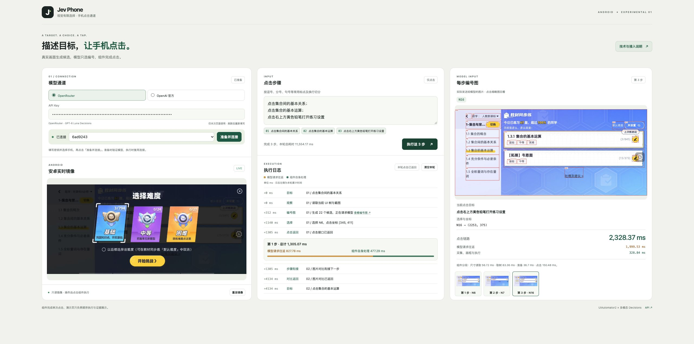

<p align="center">Demo 直接调用同一 SDK：左侧查看手机，中间查看执行过程，右侧查看模型实际接收的编号图。</p>

## 快速接入

Python 3.10+。准备已连接的设备与对应模型 Key，然后从仓库安装：

```sh
git clone https://github.com/dongxinsuperman/jev-phone.git
cd jev-phone
python3 -m venv .venv
.venv/bin/pip install -e '.[android]'
```

```python
from getpass import getpass
from jev_phone import AndroidClicker

with AndroidClicker(
    serial="YOUR_DEVICE_SERIAL",
    api_key=getpass("OpenRouter Key: "),
    provider="openrouter",
) as phone:
    report = phone.run("打开默认难度设置；选择中等难度；保存修改")
    # 单步：phone.click("打开默认难度设置")
    print(report["results"])
```

每个步骤只描述一个点击目标。`run()` 按中英文逗号、分号、句号、问号、感叹号及换行拆分，最多20步；每次模型请求只包含当前步骤。

| 平台 | 安装 | 设备连接 |
|---|---|---|
| Android | `pip install -e '.[android]'` | `AndroidClicker(serial=..., api_key=...)` |
| iOS | `pip install -e .` | `IOSClicker(wda_url=..., api_key=...)` |
| HarmonyOS | `pip install -e '.[harmony]'` | `HarmonyClicker(serial=..., api_key=...)` |

支持 OpenRouter 多模态 Decisions 和 OpenAI 官方 Decisions；官方通道使用 `provider="openai"` 及对应 Key。当前从源码或 wheel 安装，尚未发布到 PyPI。

[完整接入指南](docs/接入指南.md) · [设备准备](docs/三端设备准备.md) · [单设备示例](examples/click.py) · [多设备并行](examples/parallel.py)

## 工作原理

手机的系统树能描述区域位置，但节点文字未必表达图标的含义；截图能展示外观，还需要把识别结果绑定到可执行位置。Jev Phone 把两者结合：**用树确定候选区域，用画面理解目标，让模型选择区域编号，再由驱动执行点击。**

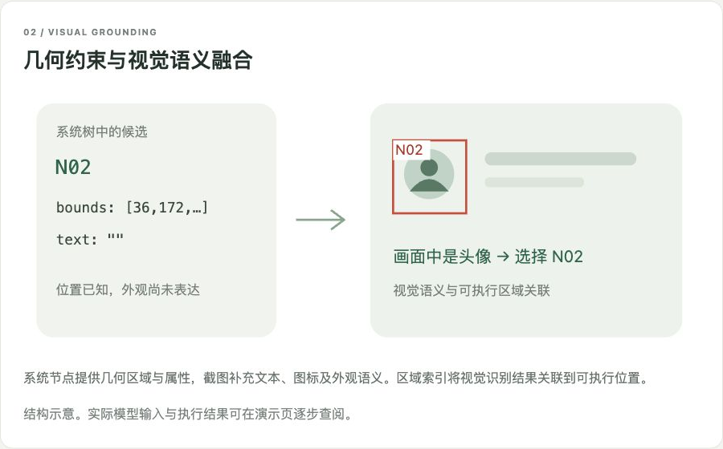

候选来自当前帧，模型返回编号、`NOT_FOUND` 或 `UNCERTAIN`。SDK 将有效编号映射到区域中心；定位或点击失败时，停止后续步骤并保留已完成结果。

<details>
<summary><strong>展开官网图解：动作绑定 · 五步流程 · 职责边界</strong></summary>

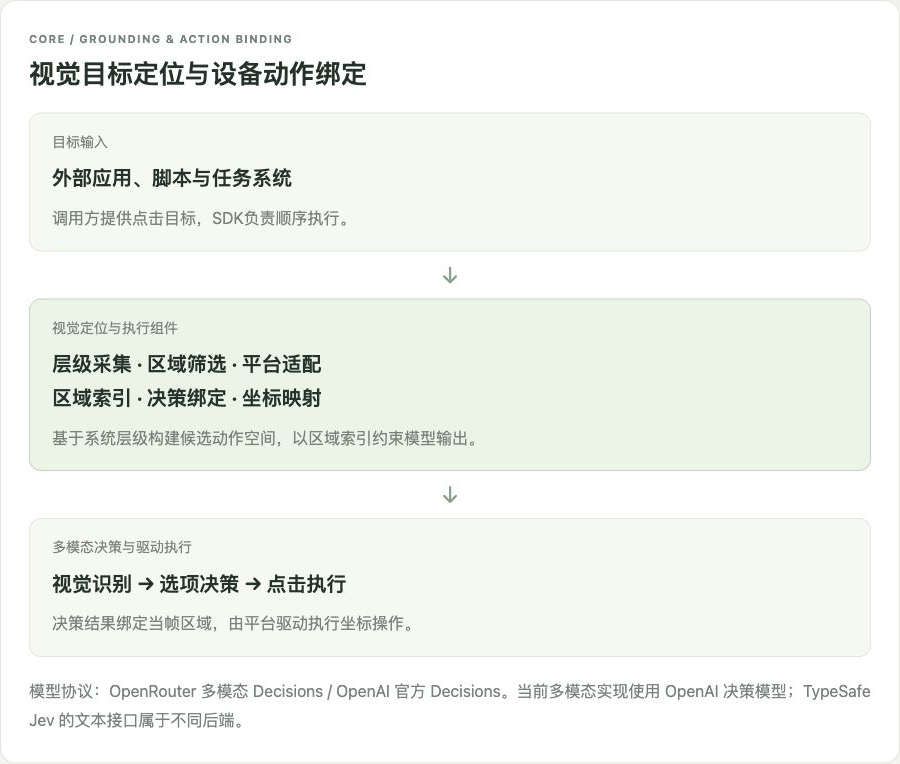
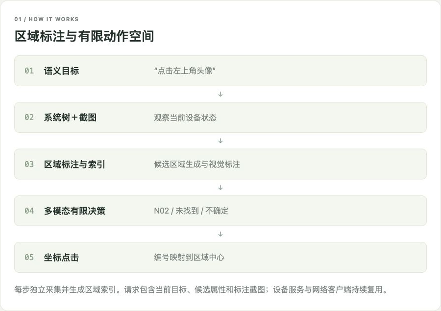
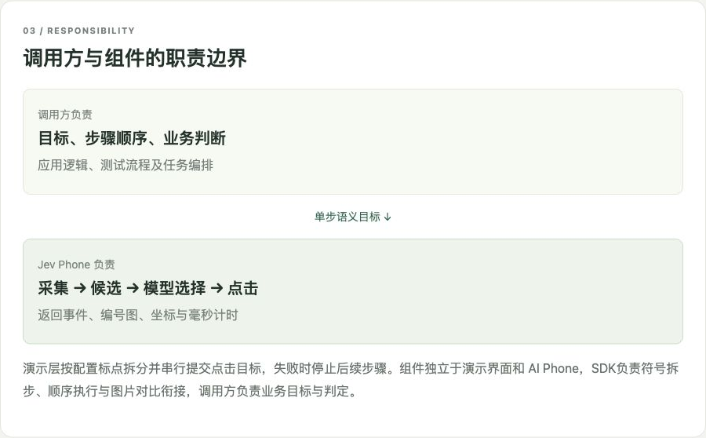

</details>

### 连续步骤怎样衔接

截图、尺寸、取树、点击和图片对比通道承接 AI Phone V3 已调实现。步骤间比较画面并复用末帧，避免下一步直接使用动画中的过渡画面；最后一步不增加衔接等待，也不逐步追加结束截图。

调用方掌握目标顺序、业务断言、缓存和异常处理。SDK 返回候选图、选中编号、坐标、驱动状态与计时；驱动返回表示点击接口完成，业务结果由调用方判断。

## 三端视觉定位

三端共用定位流程，平台适配分别处理层级、截图、坐标单位与驱动。以下是官网编号图中的目标区域，完整原图与适配卡片保留在展开项中。

| Android · 真机／虚拟机 | iOS · 真机／虚拟机 | HarmonyOS · 真机／虚拟机 |
|---|---|---|
| UiAutomator2 | WDA / XCTest | UITest / hmdriver2 |
| 原生截图、取树与点击 | 按需截图、pixel/point 映射 | 原生截图、层级与直接点击回执 |

**Android · 选择 N31**

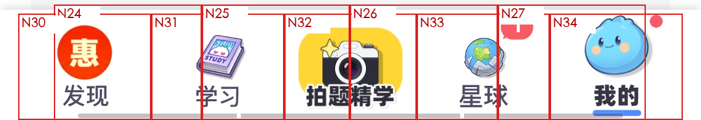

**iOS · 选择 N25**

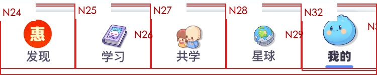

**HarmonyOS · 选择 N47**

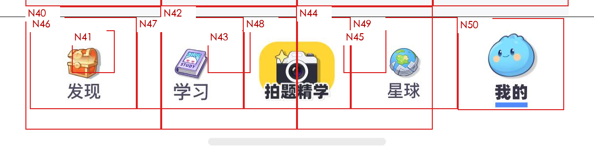

<details>
<summary><strong>展开三端官网原始卡片与完整编号图</strong></summary>

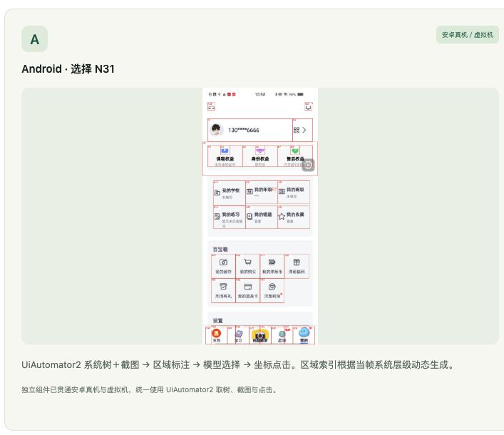
[查看Android完整编号图](docs/media/android-grounding.png)

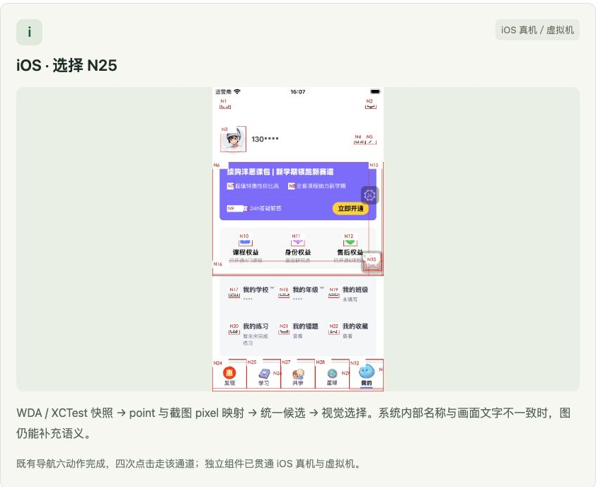
[查看iOS完整编号图](docs/media/ios-grounding.png)

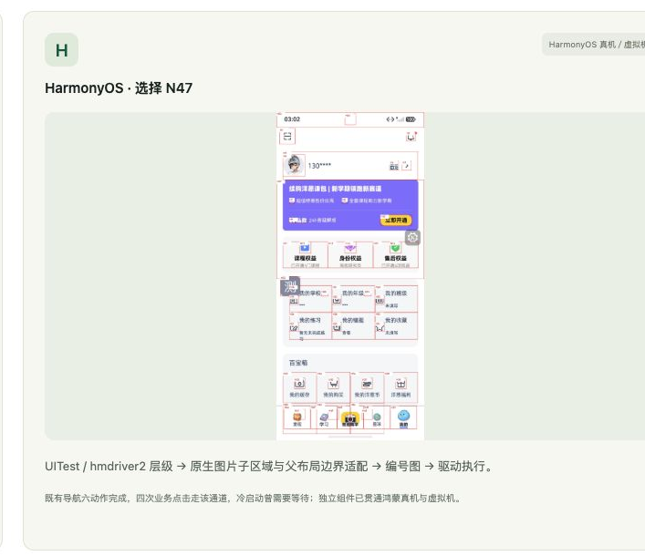
[查看HarmonyOS完整编号图](docs/media/harmony-grounding.png)

原图分别来自安卓真机、iOS虚拟机、鸿蒙虚拟机实验；各平台标题标明当前支持的设备范围。[验证概览](docs/验证概览.md)

</details>

## 性能与计时

**毫秒级本地处理**描述候选生成、画框与编码等组件处理阶段。每步完整耗时还包含设备采集、模型请求、点击，以及该步后续衔接。性能记录按这些阶段分别列出，避免用模型耗时代替整体耗时。

| 已有实验数据 | 测量范围 |
|---|---|
| **15–50ms** | 本地候选处理、画框与编码 |
| **620ms** 中位 | 安卓非模型整轮 |
| **493–729ms** | 同一安卓导航样本9轮非模型耗时范围 |

上述数据来自前期常驻 UiAutomator2 实验，不含模型请求、初始化与步骤衔接。[查看完整分段记录](docs/演示耗时明细.md)：尺寸、取树、截图、候选处理、模型往返、点击、其他开销、衔接与整体步骤。

<details>
<summary><strong>展开官网性能图与三端衔接参数</strong></summary>

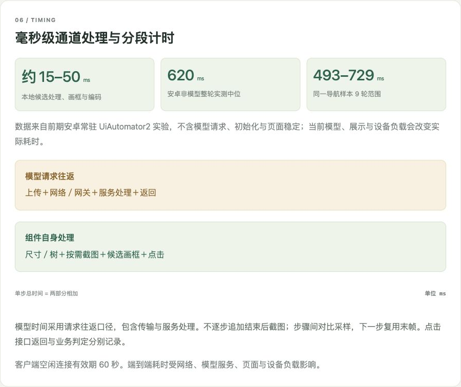

| 平台 | 额外采样间隔 |
|---|---:|
| Android | 100ms |
| iOS | 200ms |
| HarmonyOS | 0ms |

截图本身仍有耗时。对比预算耗尽时按 V3 返回最后一帧继续；参数和执行流程保持已调版本。

</details>

## Demo 与能力范围

```sh
.venv/bin/pip install -e '.[demo]'
.venv/bin/jev-phone-demo
```

准备 `adb`、`scrcpy`、`ffmpeg`，打开 `http://127.0.0.1:8765/`。网页提供安卓只读镜像、执行日志和编号图；三端 SDK 接入不依赖网页。页面刷新清除连接与 Key。

当前交付 **单步与多步点击**。任务规划、业务断言、输入、滚动、长按、应用启动与设备调度由外部系统承接。使用者准备设备授权、WDA签名与虚拟机；截图和执行记录作为本地产物保存。

<details>
<summary><strong>展开官网接入示例与实践说明</strong></summary>

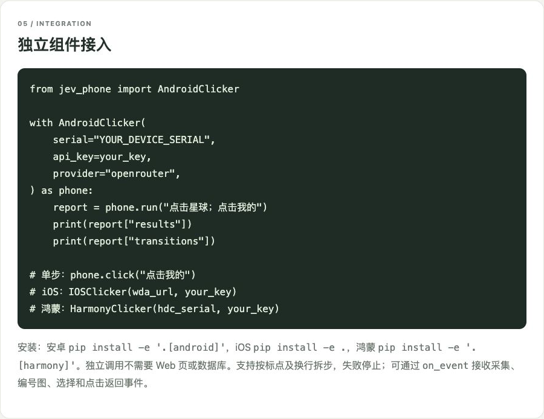
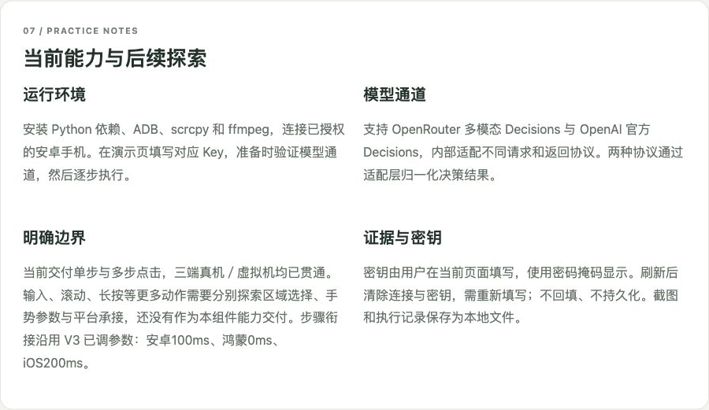

</details>

---

[中文](README.md) · [English](README.en.md) · [完整官网技术原图](docs/media/site-guide.png) · [MIT](LICENSE) · [来源说明](NOTICE.md)
